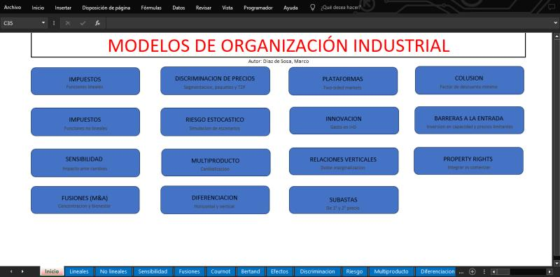

# Modelos de Organizacion Industrial (Excel + VBA)

Kit de herramientas en Excel que incluye ~20 modelos de organización industrial: fusiones, discriminación de precios, diferenciación vertical, plataformas, colusión, barreras de entrada y subastas. Los equilibrios se resuelven mediante la herramienta Solver y se automatizan con macros en VBA; además, incorporan simulación de riesgos de Montecarlo y análisis de sensibilidad sobre los supuestos.

## Navegacion

El libro de trabajo está diseñado para explorarse mediante clics, sin necesidad de buscar entre las pestañas de las hojas:

- **Hoja de inicio (`Inicio`):** cada botón azul es un hipervínculo que te lleva directamente al módulo correspondiente.
- **Submenús:** `Fusiones`, `Diferenciación` y `Rel. Vert.` funcionan como centros de navegación que contienen sus propios botones para acceder a los modelos que incluyen.
- **Botones de retorno:** cada hoja cuenta con un botón `INICIO` / `ATRÁS` para volver al menú anterior.
- **Botones de recálculo:** cada modelo dispone de un botón `Recalcular equilibrios` (una macro de VBA) que vuelve a resolver el modelo tras modificar los supuestos.

## Modulos

| Botón de inicio | Hoja(s) | Contenido |
|---|---|---|
| **Impuestos** (lineales) | `Lineales` | Impuestos específicos y *ad valorem* bajo competencia perfecta, oligopolio simétrico y monopolio, con demanda lineal |
| **Impuestos** (no lineales) | `No lineales` | Las mismas estructuras de mercado con demanda de elasticidad constante y costes cuadráticos |
| **Sensibilidad** | `Sensibilidad` | Efecto de la elasticidad, los impuestos, el número de empresas, el tamaño del mercado y la estructura de costes (constantes, lineales, cuadráticos) sobre el precio, la cantidad, los beneficios y el margen |
| **Fusiones (M&A)** | `Cournot`, `Bertrand`, `Efectos` | Simulación previa y posterior a la fusión con productos homogéneos (Cournot) y diferenciados (Bertrand); cambios en precio, cantidad, beneficios, excedente del consumidor, bienestar y el índice HHI; indicadores de efectos sobre los precios (CMCR, GUPPI, UPP, IPR) con sinergias de eficiencia |
| **Discriminación de precios** | `Discriminacion` | Precios uniformes frente a discriminación de tercer grado (segmentación), de segundo grado (paquetes/ventas conjuntas) y tarifas de dos tramos |
| **Riesgo estocástico** | `Riesgo` | Simulación de Montecarlo (5.000 iteraciones, con reoptimización mediante Solver en cada una) de beneficios y precios: mínimo, media, máximo, desviación y probabilidad de pérdidas |
| **Multiproducto** | `Multiproducto` | Canibalización, márgenes, índices de Lerner y ganancias derivadas de la coordinación |
| **Diferenciación** | `Horizontal`, `Vertical` | Posicionamiento de marca con efectos de distancia/aglomeración y cuotas de mercado; competencia en calidad-precio (oligopolio simétrico y asimétrico) |
| **Plataformas** | `Plataformas` | Mercados de dos lados (*two-sided markets*): plataformas en régimen de monopolio o duopolio con efectos de red cruzados |
| **Innovación** | `Innovacion` | Inversión en I+D bajo los modelos de Cournot, Stackelberg y una empresa conjunta de investigación (RJV, por sus siglas en inglés), con una tabla comparativa |
| **Relaciones verticales** | `Integración`, `Franquicia`, `Exclusividad` | Doble marginalización e integración vertical, franquicia (tarifa de dos tramos), contratos de exclusividad con cláusulas de rescisión |
| **Subastas** | `Subastas` | Subastas de primer y segundo precio, precio de reserva óptimo, ingresos esperados |
| **Colusión** | `Colusión` | Factor de descuento mínimo para la colusión (modelos de Cournot y de Bertrand con productos diferenciados), considerando retrasos en la notificación |
| **Barreras a la entrada** | `Barreras` | Inversión en capacidad (acomodación frente a disuasión) y fijación de precios límite |
| **Derechos de propiedad** | `Límites` | Modelo de Grossman-Hart-Moore: integración frente a intercambio (transacción en el mercado), integración hacia atrás (aguas arriba) y hacia adelante (aguas abajo) |
## Como usarlo

1. Descarga el archivo `IO models.xlsm`.
2. Ábrelo en la versión de escritorio de **Microsoft Excel** y **habilita las macros**.
3. Activa el complemento **Solver** (*Archivo > Opciones > Complementos > Administrar complementos de Excel > Complemento Solver*).
4. En la hoja principal, haz clic en el módulo que desees utilizar.
5. Modifica los datos de entrada y pulsa `Recalcular equilibrios` para realizar el nuevo cálculo.

Algunos módulos (como `Riesgo`) ejecutan miles de optimizaciones mediante Solver, por lo que el proceso puede tardar unos minutos.
